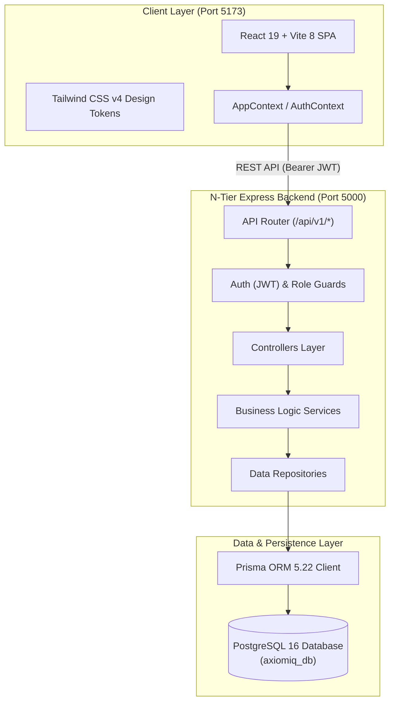
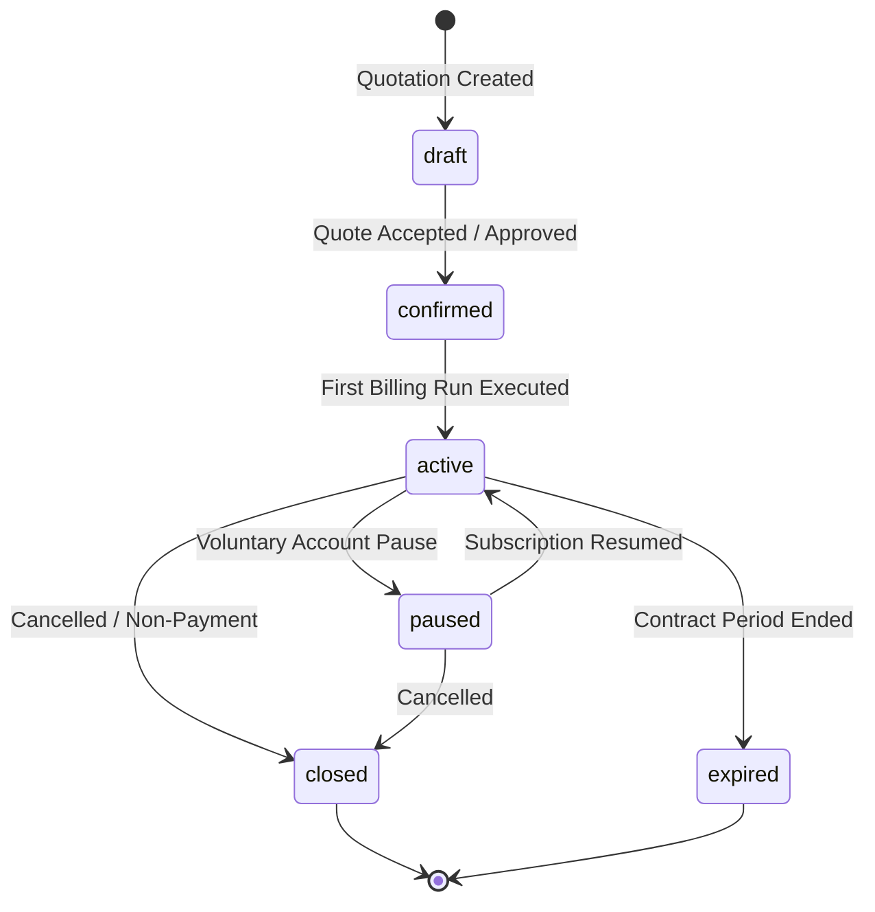

<div align="center">

  <a href="https://github.com/roshand-official/AxiomIQ_v0.1">
    
  </a>

  <p align="center">
    <b>Enterprise B2B SaaS Subscription Management &amp; Recurring Revenue Engine</b>
  </p>

[](https://github.com/roshand-official/AxiomIQ_v0.1/actions/workflows/ci.yml)
[](https://github.com/roshand-official/AxiomIQ_v0.1/actions/workflows/security.yml)
[](./LICENSE)
[](https://react.dev/)
[](https://tailwindcss.com/)
[](https://nodejs.org/)
[](https://www.postgresql.org/)
[](https://www.prisma.io/)
[](./CONTRIBUTING.md)

<p align="center">
  <b>AxiomIQ</b> is a high-performance B2B SaaS recurring billing and subscription lifecycle management platform. Engineered with modern financial principles (inspired by Stripe Dashboard, Linear, and Ramp), it unites contract state machines, automated batch billing, GST-compliant invoicing, revenue risk monitoring, and a customer self-service portal into a unified, audit-ready operations hub.
</p>

[Quick Start](#-quick-start) •
[System Architecture](#-system-architecture) •
[Key Features](#-key-features) •
[Role Portals](#-role-based-experiences) •
[API Reference](#-api-specification) •
[Contributing](#-contributing)

---

</div>

##  Executive Highlights

- ** End-to-End Enterprise Architecture**: Modern React 19 SPA powered by an N-Tier Express.js backend and normalized PostgreSQL database with Prisma ORM.
- ** Subscription Lifecycle Engine**: Rigid state machine governance (`draft` → `confirmed` → `active` → `paused` → `closed` / `expired`) preventing illegal contract state transitions.
- ** Batch Billing & Invoicing Engine**: Automated billing run orchestration, invoice calculation with dual-tax rules (CGST, SGST, IGST), and credit adjustments.
- ** Revenue Risk & Churn Monitor**: Real-time risk detection analyzing overdue dunning invoices, expiring contracts, and failed billing events.
- ** Role-Segregated Portals**: Purpose-built workspaces for **Administrators**, **Internal Account Managers (Staff)**, and **Customers (Self-Service)**.

---

##  System Architecture



### Subscription Lifecycle State Machine



---

##  Quick Start

### Prerequisites
- **Node.js**: `v18.x` or `v20.x` LTS
- **PostgreSQL**: `v15+` or `v16+` running on `localhost:5432`
- **Git**: `v2.30+`

### 1. Repository Setup
```bash
git clone https://github.com/roshand-official/AxiomIQ_v0.1.git
cd AxiomIQ_v0.1
```

### 2. Backend & Database Initialization
```bash
cd backend
npm install

# Configure your database environment
cp .env.example .env

# Push Prisma schemas and seed verified demo entities
npm run prisma:push
npm run prisma:seed

# Launch backend API server
npm run dev
```
> Backend runs at: `http://localhost:5000`

### 3. Frontend Initialization
In a separate terminal:
```bash
cd frontend
npm install

# Launch Vite development server
npm run dev
```
> Application launches at: `http://localhost:5173`

---

##  Demo Access Accounts

Use instant one-click login on `/login` or enter credentials manually:

| Role | Email | Password | Scope & Responsibilities |
|---|---|---|---|
| **Administrator** | `admin@axiomiq.io` | `Password@123` | Full system access, financial ledger, billing batch runs, settings |
| **Internal Staff** | `staff@axiomiq.io` | `Password@123` | Assigned client portfolio, account management, invoice collection |
| **Customer** | `amit@techsolutions.in` | `customer123` | Self-service portal, view contracts, download tax invoices, pay |

---

##  Key Features

### 1. Executive Operations & Analytics
- **Live KPI Dashboard**: Instant visibility into Monthly Recurring Revenue (MRR), Annual Recurring Revenue (ARR), Active Contract counts, and Accounts Receivable (AR) aging.
- **Financial Visualizations**: Interactive Recharts components displaying revenue growth curves, churn cohorts, and invoice payment velocities.
- **Audit Logging**: Comprehensive timestamped audit trail recording entity modifications and administrative actions.

### 2. Subscription & Contract Governance
- **Product & Add-on Catalog**: Flexible pricing models including base subscription licenses, usage tiers, and dynamic variant surcharges (e.g., Odoo Brand surcharges).
- **Multi-Cadence Billing Plans**: Daily, Weekly, Monthly, and Annual recurring frequencies with pause limits and renewal grace periods.
- **Interactive Action Dialogs**: One-click actions to confirm, activate, pause, resume, and terminate contracts with automatic audit logging.

### 3. Billing Engine & Tax Ledgers
- **Batch Billing Workspace**: Run automated billing evaluations for any arbitrary target date, preview eligible contracts, and generate finalized tax invoices with zero human error.
- **Dual-Tax Calculations**: Automatic allocation of CGST + SGST (Intra-state) and IGST (Inter-state) based on customer billing jurisdiction.
- **Payment Reconciliation**: Record payment receipts via NEFT/RTGS, UPI, and Credit Card with UTR tracking.

### 4. Proactive Revenue Risk Monitor
- **Risk Category Classification**: Categorizes financial vulnerabilities across overdue invoices, expiring subscriptions, and failed billing cycles.
- **Dunning Management**: Automated tracking of overdue days with direct action shortcuts to trigger collections or pause non-paying accounts.

---

## 🔌 API Specification

AxiomIQ exposes a standard RESTful API on port 5000:

| Method | Endpoint | Description | Auth Required |
|:---:|---|---|:---:|
| `POST` | `/api/v1/auth/login` | Authenticate user & receive signed JWT | No |
| `GET` | `/api/v1/auth/me` | Fetch authenticated profile & role permissions | Yes |
| `GET` | `/api/v1/customers` | Query customers with pagination, search & filters | Yes |
| `POST` | `/api/v1/customers` | Register new corporate customer profile | Yes |
| `GET` | `/api/v1/products` | Retrieve active products with plan variants | Yes |
| `GET` | `/api/v1/subscriptions` | Query subscriptions with contract status filters | Yes |
| `POST` | `/api/v1/subscriptions/:id/transition` | Transition subscription state (`pause`, `resume`, `cancel`) | Yes |
| `GET` | `/api/v1/invoices` | List tax invoices with payment status | Yes |
| `POST` | `/api/v1/invoices/:id/payments` | Record payment receipt against invoice | Yes |
| `POST` | `/api/v1/billing/run` | Execute batch recurring billing engine | Admin |
| `GET` | `/api/v1/analytics/dashboard` | Fetch aggregated financial metrics (MRR, ARR, AR) | Yes |

---

##  Repository Directory Structure

```text
AxiomIQ_v0.1/
├── .github/
│   ├── workflows/            # GitHub Actions (CI/CD, Security CodeQL, Releases)
│   ├── ISSUE_TEMPLATE/       # Structured YAML issue forms (Bug report, Feature request)
│   ├── pull_request_template.md # Production PR checklist & review criteria
│   └── dependabot.yml        # Weekly automated dependency audits
├── backend/
│   ├── prisma/
│   │   ├── schema.prisma     # 14 Normalized relational models
│   │   └── seed.js           # Database seeding script
│   └── src/
│       ├── controllers/      # HTTP request handlers & validation
│       ├── middleware/       # JWT authentication & role-based access guards
│       ├── repositories/     # Prisma data access layer
│       ├── services/         # Core business logic (Billing, Invoices, Subscriptions)
│       └── server.js         # Express app entry point
├── frontend/
│   └── src/
│       ├── components/       # Common UI, form controls, and DataTable components
│       ├── contexts/         # AppContext & AuthContext
│       ├── pages/
│       │   ├── admin/        # 14 Admin management workspaces
│       │   ├── staff/        # Internal account manager views
│       │   └── portal/       # Customer self-service views
│       └── utils/            # Formatters (INR ₹, date-fns, relative time)
├── CHANGELOG.md              # Historical version changelog
├── CODE_OF_CONDUCT.md        # Contributor Covenant v2.1
├── CONTRIBUTING.md           # Developer guidelines & Advanced Git Workflows
├── LICENSE                   # MIT License
├── SECURITY.md               # Vulnerability reporting & SLA disclosure policy
└── SUPPORT.md                # Community discussions & support channels
```

---

##  Contributing

We welcome community contributions, bug reports, and suggestions! Please review our **[Contributing Guidelines](./CONTRIBUTING.md)** and **[Advanced Git Workflows](./CONTRIBUTING.md#advanced-git-workflows-for-contributors)** before submitting PRs.

1. Fork the Project
2. Create your Feature Branch (`git checkout -b feat/AmazingFeature`)
3. Commit your Changes using [Conventional Commits](https://www.conventionalcommits.org/) (`git commit -m 'feat(billing): add prorated credit calculations'`)
4. Rebase and Squash (`git rebase -i origin/main`)
5. Push to the Branch (`git push origin feat/AmazingFeature`)
6. Open a Pull Request

---

## License

Distributed under the **MIT License**. See [`LICENSE`](./LICENSE) for more details.

---

<div align="center">
  <sub>Built with ❤️ by the <b>AxiomIQ Engineering Team</b>.</sub>
</div>
