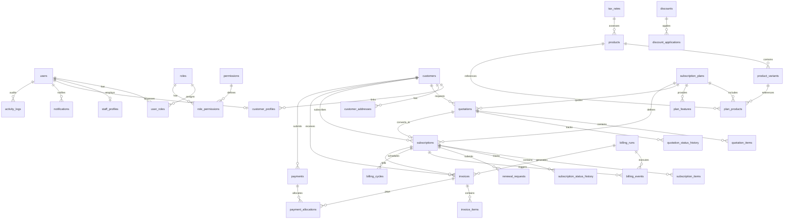

# ANOIMQI SUBSCRIPTION MANAGEMENT SYSTEM - DATABASE SCHEMA DOCUMENTATION

**Database Engine:** PostgreSQL 14+ / 16+  
**Database Name:** `anoimqi_db`  
**Total Tables:** 34  
**Primary Key Standard:** UUID (`gen_random_uuid()`)  
**Financial Values:** `NUMERIC(15, 2)`  
**Timestamps:** `TIMESTAMPTZ` with automatic `updated_at` triggers  

---

## 1. Entity-Relationship Overview



---

## 2. Table Summary by Functional Domain

| # | Domain | Table Name | Description | Key Relationships |
|---|--------|------------|-------------|-------------------|
| 1 | Auth & RBAC | `roles` | System and user access roles | 1:M with `role_permissions`, `user_roles` |
| 2 | Auth & RBAC | `permissions` | Granular action permissions per module | M:N with `roles` via `role_permissions` |
| 3 | Auth & RBAC | `role_permissions` | Role-permission junction | FK to `roles`, `permissions` |
| 4 | Auth & RBAC | `users` | Core user identity & credentials (BCrypt) | 1:1 with staff/customer profiles |
| 5 | Auth & RBAC | `user_roles` | User-role junction | FK to `users`, `roles` |
| 6 | Auth & RBAC | `staff_profiles` | Internal employee operational details | FK to `users`, self-FK to `manager_id` |
| 7 | Auth & RBAC | `customer_profiles` | Customer portal logins & access status | FK to `users`, `customers` |
| 8 | Customers | `customers` | Corporate client entities, credit limit, tax ID | 1:M with addresses, subscriptions, invoices |
| 9 | Customers | `customer_addresses` | Multiple billing and shipping addresses | FK to `customers` |
| 10 | Products | `products` | Base recurring and one-time catalog products | 1:M with variants, plan items |
| 11 | Products | `product_variants` | SKUs, tier definitions, unit & cost pricing | FK to `products` |
| 12 | Plans | `subscription_plans` | Daily, weekly, monthly, and yearly plan packages | 1:M with plan products and features |
| 13 | Plans | `plan_products` | Bundled product variants and included allowances | FK to `plans`, `products`, `variants` |
| 14 | Plans | `plan_features` | Plan feature list, values, and highlights | FK to `subscription_plans` |
| 15 | Quotations | `quotations` | Sales quotes before conversion to subscriptions | FK to `customers`, `plans`, `staff_profiles` |
| 16 | Quotations | `quotation_items` | Individual line items on quotes | FK to `quotations`, `products`, `variants` |
| 17 | Quotations | `quotation_status_history` | Audit trail of quotation status transitions | FK to `quotations`, `users` |
| 18 | Subscriptions | `subscriptions` | Active, paused, closed recurring subscriptions | FK to `customers`, `plans`, `quotations` |
| 19 | Subscriptions | `subscription_items` | Active recurring and add-on products | FK to `subscriptions`, `products`, `variants` |
| 20 | Subscriptions | `subscription_status_history` | Lifecycle state transitions log | FK to `subscriptions`, `users` |
| 21 | Subscriptions | `renewal_requests` | Customer portal requests (renew, pause, upgrade) | FK to `subscriptions`, `customers`, `plans` |
| 22 | Billing | `billing_runs` | Batch recurring billing run executions | 1:M with billing events and invoices |
| 23 | Billing | `billing_events` | Idempotent event logs preventing duplicate invoices | FK to `billing_runs`, `subscriptions`, `invoices` |
| 24 | Billing | `billing_cycles` | Pre-computed recurring billing cycles | FK to `subscriptions`, `invoices` |
| 25 | Invoices | `invoices` | Official tax invoices, subtotal, tax, balances | FK to `customers`, `subscriptions`, `billing_runs` |
| 26 | Invoices | `invoice_items` | Individual invoiced product items | FK to `invoices`, `products`, `variants` |
| 27 | Payments | `payments` | Customer payment records (UPI, Card, Bank) | 1:M with payment allocations |
| 28 | Payments | `payment_allocations` | Granular allocation of payments against invoices | FK to `payments`, `invoices` |
| 29 | Discounts | `discounts` | Percentage and fixed amount coupons | 1:M with discount applications |
| 30 | Discounts | `discount_applications` | Applied discounts across quotes, subs, invoices | FK to `discounts`, `customers`, etc. |
| 31 | Tax | `tax_rates` | Statutory tax rates (e.g., GST 18%, 12%, 5%) | Reference table for invoicing |
| 32 | System | `notifications` | User notifications for billing, renewals, security | FK to `users` |
| 33 | System | `activity_logs` | Immutable audit trail of administrative actions | FK to `users` |
| 34 | System | `system_settings` | Global configurations (currency, grace periods) | Key-value system config |

---

## 3. Financial Calculation Standards

All monetary calculations in `anoimqi_db` adhere to strict financial integrity rules:

1. **Line Subtotal:**  
   $$\text{Line Total} = \text{Quantity} \times \text{Unit Price} - \text{Line Discount} + \text{Line Tax}$$
2. **Invoice Balance Calculation:**  
   $$\text{Balance Amount} = \text{Total Amount} - \sum(\text{Allocated Payments})$$
3. **Monthly Recurring Revenue (MRR):**  
   - Normalized to monthly terms for all active recurring subscriptions:
     - Monthly: $\text{Base Amount}$
     - Yearly: $\text{Base Amount} / 12$
4. **Annual Recurring Revenue (ARR):**  
   $$\text{ARR} = \text{MRR} \times 12$$
5. **Idempotent Billing Runs:**  
   `billing_events.idempotency_key` ensures no duplicate invoices are created for the same cycle.

---

## 4. Execution Commands

### PostgreSQL CLI:
```bash
psql -U postgres -d anoimqi_db -f database/schema.sql
psql -U postgres -d anoimqi_db -f database/seed.sql
psql -U postgres -d anoimqi_db -f database/verify_db.sql
```
